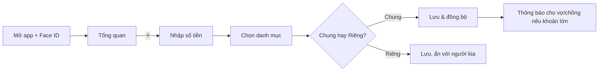

# Ví Đôi – App quản lý chi tiêu cho 2 vợ chồng (iOS)

## 1. Mục tiêu & nguyên tắc
- Ghi một khoản chi trong **≤ 5 giây**, dùng một tay.
- Mỗi người có tài khoản riêng; liên kết thành **Gia đình** (tối đa 2 thành viên).
- Chia sẻ linh hoạt: **Chung** (cả hai thấy) và **Riêng** (chỉ chủ thấy, vợ/chồng chỉ thấy trong tổng nếu bật).
- Minh bạch, không gây áp lực: tập trung "chúng ta", không soi nhau.
- Tiếng Việt, VND (định dạng `1.250.000 ₫`).

## 2. Tài khoản & liên kết gia đình
| Bước | Mô tả |
|---|---|
| Đăng ký | Sign in with Apple / Email / SĐT (OTP). Face ID để mở app. |
| Tạo gia đình | Người 1 tạo "Gia đình", nhận **mã mời 6 ký tự** hoặc link/QR. |
| Tham gia | Người 2 đăng nhập → nhập mã/quét QR → Người 1 xác nhận. |
| Quyền | Ngang quyền. Cài đặt nhạy cảm (xóa ví chung, rời gia đình) cần cả hai đồng ý. |
| Rời gia đình | Dữ liệu chung giữ lại (ẩn danh người rời nếu muốn), dữ liệu riêng mang theo. |

## 3. Chức năng

### MVP
1. **Ghi giao dịch nhanh**: số tiền (bàn phím số lớn) → danh mục → ví → ghi chú/ảnh hóa đơn → loại *Chung/Riêng*. Chọn "ai chi" (mặc định = tôi).
2. **Ví/Tài khoản**: tiền mặt, ngân hàng, thẻ tín dụng, ví điện tử; ví **Chung** và ví **Riêng**. Chuyển tiền giữa các ví.
3. **Danh mục** (tùy chỉnh): Ăn uống, Chợ/Siêu thị, Nhà cửa, Hóa đơn, Đi lại, Con cái, Sức khỏe, Giải trí, Quà/Hiếu hỷ, Mua sắm, Thu nhập (Lương, Thưởng, Khác).
4. **Tổng quan (Home)**: số dư chung, thu/chi tháng, ngân sách còn lại, giao dịch gần đây của cả hai.
5. **Ngân sách**: theo danh mục/tháng; cảnh báo 80% và 100%; ngân sách chung & riêng.
6. **Báo cáo**: biểu đồ tròn theo danh mục, cột theo tháng, so sánh "Chồng/Vợ/Chung", xuất CSV/PDF.
7. **Thông báo**: khi người kia ghi khoản lớn (ngưỡng tùy chỉnh), vượt ngân sách, nhắc ghi chép cuối ngày.
8. **Đồng bộ realtime** (iCloud/CloudKit hoặc Firebase) + hoạt động offline.

### Giai đoạn 2
- **Cân đối chi tiêu chung**: ai đã chi bao nhiêu cho khoản chung, gợi ý "hôm nay A cần chuyển cho B xxx" (hoặc tỷ lệ đóng góp theo thu nhập, vd 60/40).
- **Mục tiêu tiết kiệm chung** (mua nhà, du lịch, quỹ con) với thanh tiến độ.
- **Giao dịch định kỳ** (tiền nhà, internet, học phí) & nhắc hạn hóa đơn, khoản vay/nợ.
- **Quét hóa đơn (OCR)**, nhập nhanh bằng giọng nói/Siri Shortcut ("Chi 50 nghìn ăn sáng").
- **Widget** màn hình chính + Live Activity, Apple Watch ghi nhanh.
- **Chat/Bình luận** trên giao dịch ("Khoản này là gì vậy anh?").
- **Tự nhập từ SMS/Thông báo ngân hàng** (Shortcut Automation).
- Đa tiền tệ, chế độ tối.

## 4. Quyền riêng tư (Chung vs Riêng)
| Mục | Hiển thị cho vợ/chồng |
|---|---|
| Giao dịch **Chung** | Thấy đầy đủ |
| Giao dịch **Riêng** | Ẩn chi tiết. Tùy chọn: *Ẩn hoàn toàn* / *Chỉ tính vào tổng, hiện "Chi riêng"* |
| Ví Riêng | Mặc định ẩn số dư; có thể "Chia sẻ chỉ xem" |
| Ngân sách riêng | Chỉ chủ thấy |
Biểu tượng 🔒 trên mọi mục riêng để tránh nhầm lẫn.

## 5. Cấu trúc điều hướng (Tab bar)
```
[Tổng quan] [Giao dịch] [ ＋ ] [Ngân sách] [Gia đình]
```
- **＋** nút nổi giữa tab bar, nổi bật.
- Báo cáo nằm trong Tổng quan (nút "Xem báo cáo") và tab Giao dịch (bộ lọc).

## 6. Màn hình chính
1. **Onboarding**: 3 slide giá trị → đăng nhập → tạo/tham gia gia đình → tạo ví đầu tiên.
2. **Tổng quan**: chào theo tên; thẻ "Chi tháng này" + vòng ngân sách; chip chuyển *Chúng ta / Tôi / Vợ(Chồng)*; top danh mục; giao dịch gần đây có avatar người ghi.
3. **Thêm giao dịch** (bottom sheet): tab Chi/Thu/Chuyển; số tiền lớn; lưới danh mục biểu tượng; dòng ví, ngày, ghi chú; công tắc **Chung/Riêng**; nút Lưu.
4. **Danh sách giao dịch**: nhóm theo ngày, tìm kiếm, lọc (người/ví/danh mục), vuốt trái xóa – phải sửa.
5. **Ngân sách**: danh sách thanh tiến độ màu (xanh <80%, cam 80–100%, đỏ >100%).
6. **Báo cáo**: chọn tháng, donut + danh sách, so sánh hai người.
7. **Gia đình**: avatar 2 người, mã mời, ví chung, mục tiêu, cài đặt quyền riêng tư, thông báo, bảo mật, xuất dữ liệu.

## 7. Luồng chính


## 8. Hệ thống thiết kế (iOS HIG)
- **Phong cách**: ấm áp, thân thiện, tối giản; bo góc 16–20pt; thẻ nền trắng trên nền xám nhạt.
- **Màu**: Chủ đạo Coral `#FF6B6B`; Phụ Teal `#2EC4B6`; Chồng `#4C8DFF`; Vợ `#FF7EB6`; Chung `#7C5CFF`; Thu `#22C55E`; Chi `#EF4444`; Cảnh báo `#F59E0B`.
- **Chữ**: SF Pro; số tiền dùng SF Rounded/Monospaced digits; Large Title 34, Body 17.
- **Thành phần**: SF Symbols, haptic khi lưu, bottom sheet, swipe actions, Dynamic Type, Dark Mode, VoiceOver.
- **Chạm**: vùng ≥ 44pt; thao tác chính ở nửa dưới màn hình.
- **Trạng thái rỗng**: minh họa dễ thương + nút hành động ("Ghi khoản chi đầu tiên").

## 9. Mô hình dữ liệu
```
User(id, tên, avatar, màu)
Family(id, mã_mời, thành_viên[2])
Wallet(id, family_id, owner_id|null, tên, loại, số_dư, visibility[shared|private])
Category(id, family_id, tên, icon, loại)
Transaction(id, wallet_id, user_id, số_tiền, category_id, ngày, ghi_chú, ảnh, visibility, định_kỳ?)
Budget(id, family_id, category_id, tháng, hạn_mức, scope[shared|private], owner_id?)
Goal(id, family_id, tên, mục_tiêu, đã_có, hạn)
```

## 10. Công nghệ đề xuất
SwiftUI + SwiftData/CoreData (offline), đồng bộ **CloudKit Shared Database** (không cần server, chia sẻ giữa 2 Apple ID) hoặc Firebase (Auth + Firestore) nếu cần Android sau này. Swift Charts cho biểu đồ, WidgetKit, App Intents (Siri).

## 11. Lộ trình
1. Tuần 1–2: Auth, liên kết gia đình, ví, thêm/sửa giao dịch.
2. Tuần 3–4: Tổng quan, ngân hàng ngân sách, báo cáo, thông báo.
3. Tuần 5–6: Chung/Riêng hoàn chỉnh, cân đối chi tiêu, TestFlight.
4. Sau đó: OCR, widget, mục tiêu, định kỳ.

**Mockup tương tác:** mở [mockup.html](mockup.html) trong trình duyệt.
